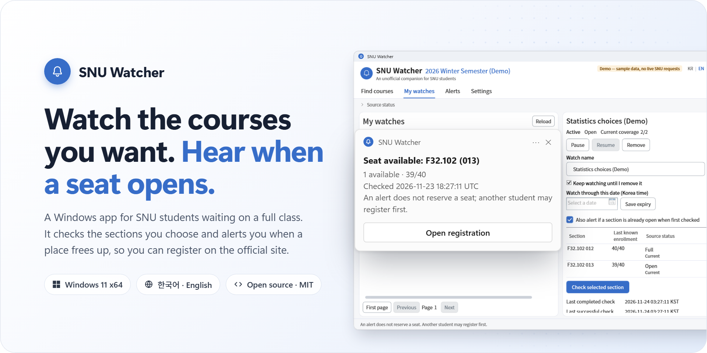

<div align="center">

<p>
<picture>
  <source media="(prefers-color-scheme: dark)" srcset="docs/assets/readme/hero-dark.png">
  
</picture>
</p>

<a href="https://github.com/DuckFard/SNU-watcher/releases/tag/v0.1.0-preview.2"></a>

<a href="LICENSE"></a>

[English](README.md) · **한국어**

**[설치](#설치)** · [사용 방법](#사용-방법) · [자주 묻는 질문](#자주-묻는-질문) · [개인정보](#개인정보와-데이터) · [문의](#문의와-버그-신고)

</div>

SNU Watcher는 정원이 찬 강좌에 자리가 나기를 기다리는 서울대학교 학생을 위한 Windows 데스크톱 앱입니다. 선택한 강좌의 분반을 확인하다가 잔여석이 생기면 알림을 보내고, 공식 수강신청 사이트로 바로 이동할 수 있게 해 줍니다. 수강신청은 공식 사이트에서 직접 하셔야 합니다.

> [!NOTE]
> **[0.1.0-preview.2](https://github.com/DuckFard/SNU-watcher/releases/tag/v0.1.0-preview.2)는 서명되지 않은 Windows 11 x64 미리보기 버전입니다.** 강좌 검색, 관심 강좌, 잔여석 알림, 알림 기록, 알림 테스트를 제공하며, 수강신청 사이트와 비슷한 모습입니다. 알려진 제한 사항은 릴리스 노트를 확인하세요.

> [!IMPORTANT]
> **알림은 좌석을 예약하지 않습니다.** 다른 학생이 먼저 신청할 수 있고, 수강 제한도 그대로 적용됩니다. SNU Watcher는 서울대학교와 관련이 없거나 서울대학교의 승인을 받지 않은 독립 프로젝트입니다.

## 주요 기능

- **강좌 찾기** — 현재 학기의 강좌를 강좌명이나 키워드로 검색합니다. 상세 검색에서는 교과목 번호, 분반, 교수, 단과대학, 학과, 학년, 과정으로 찾을 수 있고, 아무것도 입력하지 않고 검색하면 그 학기의 모든 강좌를 볼 수 있습니다.
- **분반 비교** — 교수, 시간, 강의실, 수강신청인원, 정원, 잔여석을 확인합니다.
- **관심 강좌** — 한 분반만 지켜보거나, 한 강좌의 여러 분반을 묶어 그중 어디든 자리가 나면 알림을 받을 수 있습니다.
- **잔여석 알림** — 강좌와 분반이 표시된 Windows 알림을 받고, 알림에서 공식 수강신청 사이트를 바로 엽니다.
- **관리** — 관심 강좌를 추가, 일시 중지, 재개, 삭제하고 언제까지 지켜볼지 정합니다.
- **최신 정보 확인** — 마지막으로 성공한 조회 시각을 보여 주고, 정보가 늦어지거나 받을 수 없으면 그 이유를 알려 줍니다.
- **알림 기록** — 잔여석이 생겼던 기록과 알림 전송 상태를 보고, Windows 알림을 테스트하며, 알림 소리를 끌 수 있습니다.

## 설치

**Windows 11 x64**가 필요합니다. 설치 프로그램에 필요한 실행 환경이 포함되어 있어 다른 프로그램을 설치하지 않아도 됩니다.

1. [0.1.0-preview.2 릴리스](https://github.com/DuckFard/SNU-watcher/releases/tag/v0.1.0-preview.2)에서 `SnuCourseWatcher-0.1.0-preview.2-windows-x64-Setup.exe`와 `SHA256SUMS.txt`를 내려받습니다. 이 저장소의 릴리스 파일만 사용하세요.
2. (선택) 내려받은 파일이 게시된 파일과 같은지 PowerShell에서 확인합니다.

   ```powershell
   Get-FileHash '.\SnuCourseWatcher-0.1.0-preview.2-windows-x64-Setup.exe' -Algorithm SHA256
   ```

   결과가 `DFDD2C45F340108CBCD06E76F65F8463C2747ED3F0F214DFCAB48E7A15A0106A`이면 같은 파일입니다.
3. 설치 프로그램을 실행합니다.

### "Windows의 PC 보호" 창이 뜨는 경우

미리보기 설치 프로그램은 아직 코드 서명이 되어 있지 않아서, Windows SmartScreen이 **"Windows의 PC 보호"** 창과 함께 "알 수 없는 게시자"라고 표시할 수 있습니다. 위의 확인 값이 같다면 **추가 정보**를 누른 뒤 **실행**을 누르면 설치됩니다. 브라우저가 내려받기를 막으면 내려받기 목록에서 **유지**를 선택하세요.

### 스마트 앱 컨트롤이 켜져 있는 경우

**스마트 앱 컨트롤**(Windows 보안 > 앱 및 브라우저 컨트롤)이 켜진 PC에서는 Windows가 서명되지 않은 앱을 막고 "실행" 선택지를 주지 않으므로, 지금의 미리보기는 그 PC에서 실행할 수 없습니다. 코드 서명된 버전을 준비하고 있습니다.

### 업데이트와 제거

- **업데이트** — 자동 업데이트는 아직 없습니다. [릴리스 페이지](https://github.com/DuckFard/SNU-watcher/releases)에서 새 버전을 내려받아, SNU Watcher를 종료한 뒤 설치하면 됩니다. 관심 강좌, 설정, 알림 기록은 그대로 유지됩니다.
- **제거** — Windows 설정 > 앱 > 설치된 앱에서 SNU Watcher를 제거합니다. 관심 강좌 데이터는 기본적으로 남겨 둡니다([데이터 위치](#개인정보와-데이터)).

## 사용 방법

1. **원하는 강좌를 찾습니다.** SNU Watcher가 수강신청 사이트에서 현재 학기를 읽어 검색창 위에 보여 주므로 학기를 따로 고를 필요가 없습니다. 오른쪽 위의 "KR | EN"으로 언어를 바꿀 수 있습니다.
2. **분반이나, 괜찮은 분반 묶음을** 관심 강좌에 추가합니다.
3. **SNU Watcher를 켜 둡니다.** 창을 닫으면 작업 표시줄 오른쪽의 트레이에서 계속 확인합니다(설정에서 바꿀 수 있습니다). PC가 꺼져 있거나 절전 모드이거나 앱을 종료하면 확인하지 않습니다.
4. **잔여석 알림이 오면** 알림을 눌러 [공식 수강신청 사이트](https://sugang.snu.ac.kr/sugang/co/co010.action)를 열고 직접 신청합니다.

## 자주 묻는 질문

**얼마나 자주 확인하나요?**
설정의 조회 간격에 따라 관심 강좌마다 약 60초(기본), 30초(빠르게) 또는 120초(낮은 빈도)마다 확인합니다. 서울대 서버에 부담을 주지 않도록 요청 사이에 최소 2초 간격을 두고, 사이트가 바쁘거나 점검 중이면 스스로 더 천천히 확인합니다. 그래서 관심 강좌가 많으면 실제 간격이 설정보다 길어질 수 있습니다.

**수강신청을 대신 해 주나요?**
아니요. SNU Watcher는 로그인하지 않고 공개된 잔여석 정보만 읽습니다. 자동으로 수강신청하지 않으며, 신청은 공식 사이트에서 직접 해야 합니다.

**알림이 보이지 않아요.**
설정 페이지의 **알림 테스트**에서 테스트 알림을 보내 보세요. Windows 설정 > 시스템 > 알림에서 알림과 SNU Watcher가 켜져 있는지, **방해 금지**나 **집중** 모드가 켜져 있지 않은지 확인하세요. 알림이 Windows에 전달되어도 실제로 화면에 표시될지는 Windows 설정이 결정합니다.

**잔여석이 있다고 했는데 신청할 수 없어요.**
알림은 확인한 시점의 수강신청인원과 정원을 기준으로 합니다. 그 사이 다른 학생이 신청했거나, 학년·학과 제한 등으로 본인이 신청할 수 없는 자리일 수 있습니다.

**서울대학교 공식 앱인가요?**
아니요. 서울대학교와 관련이 없거나 서울대학교의 승인을 받지 않은 독립 오픈 소스 프로젝트입니다.

## 개인정보와 데이터

- 서울대 계정 정보를 묻지 않고, 로그인하거나 브라우저 쿠키를 가져오지 않습니다.
- 강좌 목록·검색·상세 정보를 익명으로 공식 수강신청 서비스에 요청합니다. 서울대와 네트워크 제공자는 이 요청과 IP 주소를 볼 수 있습니다.
- 프로젝트가 운영하는 서버, 사용 통계, 자동 오류 보고가 없으며, 관심 강좌나 데이터베이스를 업로드하지 않습니다.
- 관심 강좌, 알림 기록, 설정은 이 PC의 `%LOCALAPPDATA%\DuckFard\SnuWatcher`에 저장됩니다. 앱이 따로 암호화하지 않으므로 시간표처럼 보호하세요.
- 진단 내보내기는 직접 선택했을 때만 이 PC에 파일로 저장되며, 강좌, 관심 강좌 이름, 경로 같은 개인 정보를 담지 않습니다.

자세한 내용은 [개인정보와 로컬 데이터](docs/privacy.md)(영문)를 참고하세요.

## 문의와 버그 신고

- 문제나 제안은 [GitHub Issues](https://github.com/DuckFard/SNU-watcher/issues)에 남겨 주세요. 관심 강좌 데이터베이스, 개인 정보, 확인하지 않은 로그는 첨부하지 마세요. 필요하면 설정의 진단 내보내기 파일을 확인한 뒤 첨부하세요.
- 보안 문제는 공개 이슈가 아니라 [보안 정책](SECURITY.md)에 따라 알려 주세요.
- 개발과 빌드 방법은 [영문 README](README.md#develop-locally)를 참고하세요.

## 라이선스

이 프로젝트의 코드와 문서는 [MIT 라이선스](LICENSE)를 따릅니다(Copyright 2026 DuckFard). 외부 구성 요소, 서울대학교 데이터와 상표 등 외부 콘텐츠에는 각각의 조건이 적용됩니다.
