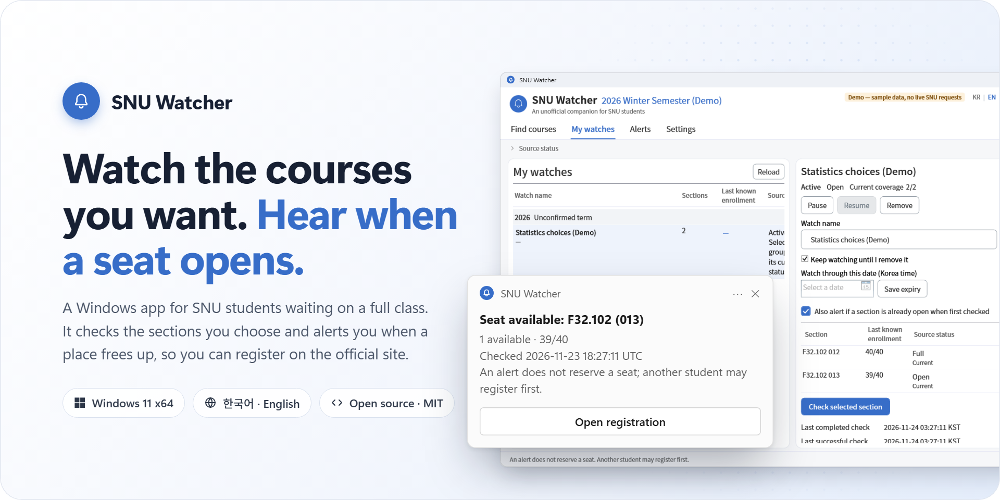
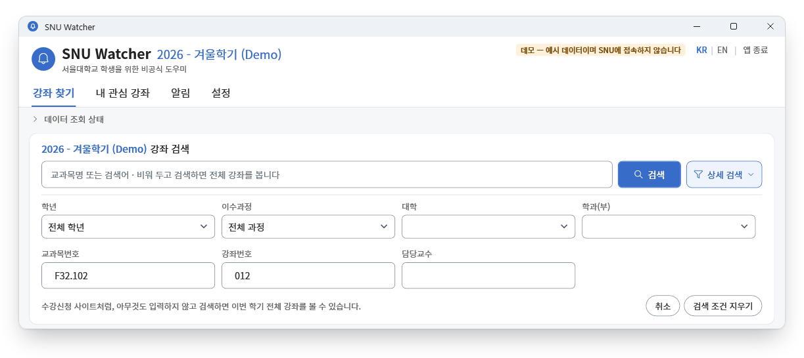
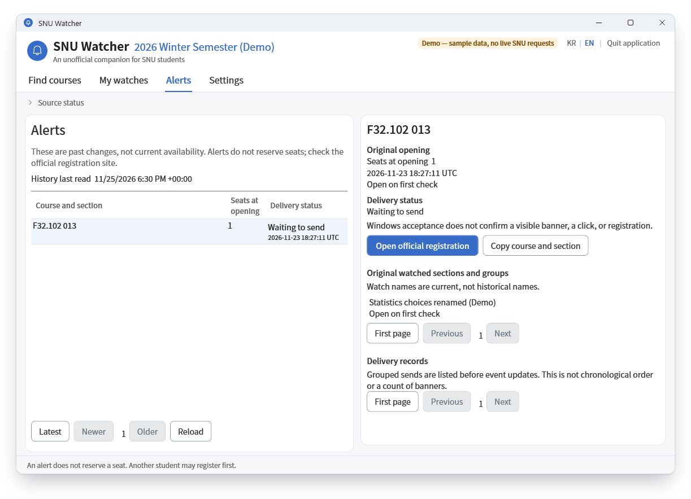
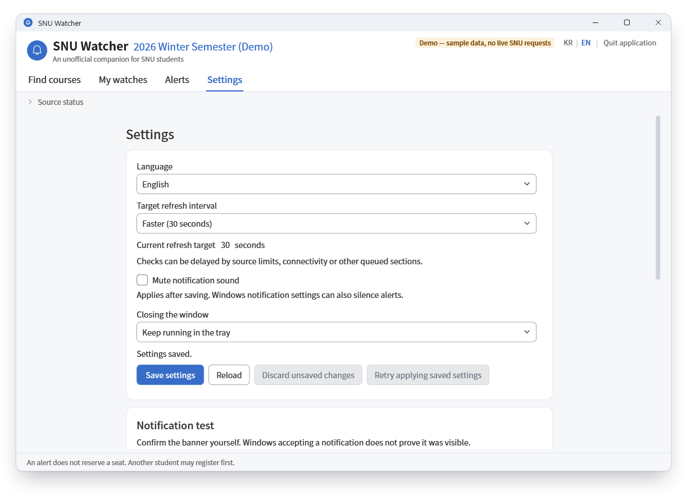

<div align="center">

<p>
<picture>
  <source media="(prefers-color-scheme: dark)" srcset="docs/assets/readme/hero-dark.png">
  
</picture>
</p>

<a href="https://github.com/DuckFard/SNU-watcher/releases/tag/v0.1.0-preview.2"></a>
<a href="https://github.com/DuckFard/SNU-watcher/actions/workflows/foundation.yml?query=branch%3Amain"></a>

<a href="LICENSE"></a>

**[Download](#download)** · [How it works](#how-it-works) · [Screens](#a-look-inside) · [Privacy](docs/privacy.md) · [Develop](#develop-locally)

</div>

SNU Watcher is a Windows desktop app for Seoul National University students who are waiting for a place in a full class. It checks the sections you choose, alerts you when a seat becomes available, and takes you to the official SNU registration page so you can try to register.

> [!NOTE]
> **[0.1.0-preview.2](https://github.com/DuckFard/SNU-watcher/releases/tag/v0.1.0-preview.2) is an unsigned Windows 11 x64 prerelease** with course search, watchlists, native seat alerts, saved alert history and notification testing, in a look modeled on the course registration site. Its exact installer passed installed Windows, notification and accessibility checks before publication, and installing it from the release page was checked afterwards. Read the release notes for known limitations, and the [development progress](docs/PROGRESS.md) for the evidence.

## What it does

<table>
<tr>
<td width="33%" valign="top">
<br>
<b>Find courses</b><br>
Search the current term by course name or keyword, or open Advanced search for code, section, instructor, college, department, grade or degree program. Search with nothing entered to list every course in the term, page by page.
</td>
<td width="33%" valign="top">
<br>
<b>Compare sections</b><br>
View instructors, schedules, locations, enrollment, capacity, and available seats.
</td>
<td width="33%" valign="top">
<br>
<b>Build a watchlist</b><br>
Watch one exact section or group several sections under a course, such as any selected section of College Writing.
</td>
</tr>
<tr>
<td valign="top">
<br>
<b>Get seat alerts</b><br>
Receive a Windows popup identifying the course and section, with a shortcut to official SNU registration.
</td>
<td valign="top">
<br>
<b>Manage your watches</b><br>
Add, pause, resume, or remove watches, and choose when they expire.
</td>
<td valign="top">
<br>
<b>Check data freshness</b><br>
See the last successful check and clear status messages when information is delayed or unavailable.
</td>
</tr>
<tr>
<td valign="top">
<br>
<b>Review alerts</b><br>
Browse saved opening events and delivery status, test Windows notifications, and choose whether alerts make a sound.
</td>
<td valign="top">
<br>
<b>Explore further</b><br>
Open SNU Genie in your browser for additional course information.
</td>
<td valign="top">
<br>
<b>Check local health</b><br>
Read cached notification/source status and storage sizes, and export a small privacy-safe diagnostic summary locally.
</td>
</tr>
</table>

## A look inside

<table>
<tr>
<td colspan="2"></td>
</tr>
<tr>
<td colspan="2" align="center"><sub><b>Find courses</b>, here in Korean: the term is shown above the search box, and Advanced search adds the detailed filters.</sub></td>
</tr>
<tr>
<td width="50%"></td>
<td width="50%"></td>
</tr>
<tr>
<td align="center" valign="top"><sub><b>Alerts</b> keep each opening and its delivery status.</sub></td>
<td align="center" valign="top"><sub><b>Settings</b> cover language, check interval, sound and the tray.</sub></td>
</tr>
</table>

<sub>These screens use the app's offline demo data, marked by the yellow badge, so they show no live SNU data.</sub>

## How it works

1. **Find the course you want.** SNU Watcher reads the current term from the registration site and shows it above the search box, so there is no term to select. Use "KR | EN" at the top right to switch language.
2. **Add a section, or a group of acceptable sections,** to your watchlist.
3. **Keep SNU Watcher running** while it checks for availability changes.
4. **When a seat opens,** click the notification to open the [official SNU registration site](https://sugang.snu.ac.kr/sugang/co/co010.action) and register yourself.

> [!IMPORTANT]
> **An alert does not reserve a seat.** Another student may register first, and registration restrictions still apply. SNU Watcher leaves registration to you on the official site.

SNU Watcher is an independent project and is not affiliated with or endorsed by Seoul National University.

## Download

The preview targets **Windows 11 x64**. The installer includes its runtimes, so no development tools are needed.

1. Download `SnuCourseWatcher-0.1.0-preview.2-windows-x64-Setup.exe` and `SHA256SUMS.txt` from the [0.1.0-preview.2 release](https://github.com/DuckFard/SNU-watcher/releases/tag/v0.1.0-preview.2).
2. Before running it, check that its SHA-256 matches `SHA256SUMS.txt`:

   ```powershell
   Get-FileHash '.\SnuCourseWatcher-0.1.0-preview.2-windows-x64-Setup.exe' -Algorithm SHA256
   ```

   The expected value is `DFDD2C45F340108CBCD06E76F65F8463C2747ED3F0F214DFCAB48E7A15A0106A`.
3. Run the installer.

**Upgrading from preview.1?** Quit SNU Watcher and run the new installer. It installs to the same per-user folder and keeps your watches, settings and alert history.

This is an **unsigned GitHub prerelease**, so Windows may show publisher or reputation warnings. Use only this repository's release assets. A checksum confirms the download matches the published file; it does not prove who published it. Dependency notices, a scoped SBOM and build metadata accompany the installer.

The preview uses manual upgrades from GitHub Releases. Automatic updates/startup, watch backup/export and automatic history pruning are deferred. The local storage warning is set at 256 MiB and does not delete data or impose a hard limit. See [privacy and local data](docs/privacy.md) and [preview diagnostics](docs/diagnostics.md).

The earlier command-line prototype is preserved in [legacy/python-watcher](legacy/python-watcher/), along with its setup instructions and known limitations.

## Develop locally

The desktop uses **C# / .NET 10 and WPF**, with native Windows notifications and SQLite for local watches and delivery records. Search, watch management and English/Korean settings use owned asynchronous controllers; availability and the last successful check remain separate from loading and error states. The notification integration records Windows acceptance separately from a student's confirmation that a test banner appeared. Installed-app qualification for the published preview is recorded in [native validation](docs/native-validation.md).

The **2026-11-02** live recheck passed catalog, two-page search, exact section details and previous-year metadata through the production gateway. The adapter now follows SNU's observed catalog initialization flow and validates source-reported academic years. Unsupported responses still produce unavailable data rather than invented availability. See the [integration evidence](docs/integrations/snu.md); these reads do not establish an institution-approved polling rate.

The desktop app is on the `main` branch. On Windows 11 x64, install the exact .NET SDK version pinned in [global.json](global.json), then run:

```powershell
git clone https://github.com/DuckFard/SNU-watcher.git
cd SNU-watcher
.\scripts\Test-Foundation.ps1
```

The script restores locked dependencies, builds the solution, and runs the offline foundation tests with an 80% line and branch coverage requirement. These tests do not log into SNU, submit registrations, or send Windows notifications.

See [native validation](docs/native-validation.md) for instructions to build the current test app and installer. Installer builds also require Inno Setup.

## Project documentation

- [Development progress](docs/PROGRESS.md) — implemented work, test evidence, and open milestones.
- [Implementation plan](docs/DESKTOP_APP_PLAN.md) — feature scope, monitoring behavior, and release requirements.
- [Architecture](docs/architecture.md) — application structure and design decisions.
- [SNU integration](docs/integrations/snu.md) — data sources, verified behavior, and limitations.
- [Testing](docs/testing.md) — automated checks and coverage requirements.
- [Privacy](docs/privacy.md) and [security policy](SECURITY.md) — local data, diagnostic sharing and vulnerability reporting.
- [Preview releases](docs/releases.md) — unsigned packaging, verification, manual upgrade and recovery limits.

## License

Original project code and documentation are licensed under the [MIT License](LICENSE), copyright 2026 DuckFard. Third-party dependencies, SNU data, branding, and other external content retain their respective terms.
